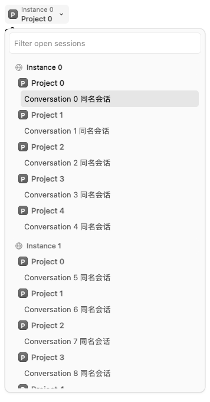
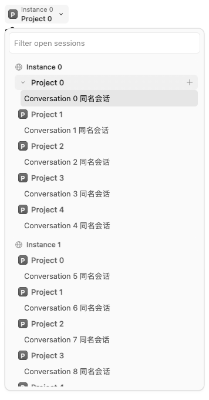

# Instance and project tab groups

Grouping orders each OpenCode connection as one contiguous block, then groups its sessions and drafts by project. Matching project names and paths on different connections never merge. Worktree/directory resolution and native project-scoped session dragging remain unchanged.

## Quiet sidebar and horizontal navigation

Sidebar headings show an instance name or a project avatar/name. They omit counts, order menus, and permanently visible collapse arrows. Hover or keyboard focus reveals the arrow; the native hover title explains whether a click expands or collapses the group. Click, Enter or Space toggles it. Selecting a conversation reveals both owning groups, while users can still fold the active group themselves.

Project headings also reveal a separate **+** button on hover or keyboard focus, with a project-specific accessible label and tooltip. It opens a native draft tab on the heading's connection and project root, independent of the current session or the first session's worktree. It works while the project is folded and closes the horizontal browser after activation. Groups without a known directory or registered connection omit the action. Touch devices and the mobile drawer keep the button visible.

The title, collapse arrow and create action share one continuous hover/focus background and pressed surface. The project avatar and collapse arrow share the same fixed 16px leading slot: the avatar appears normally, and hovering the heading or focusing a control with the keyboard replaces it with the arrow. The title stays in place and the right edge contains only the create action. Individual controls retain their keyboard focus outlines.

| Default | Hover |
| --- | --- |
|  |  |

Desktop headings are 26px high; grouped sidebar conversations are 32px high with 2px gaps. Shallower indentation and smaller group margins keep the hierarchy compact. The horizontal browser uses 28px conversation rows. Mobile drawer headings and conversations retain 44px rows with a 36px create button. Sticky offsets and scroll padding follow these row sizes.

Group ordering is mouse-drag only: drag an instance heading over another instance, or a project heading over a sibling in the same instance. The upper/lower half of a heading selects insertion before/after it, with a matching insertion line. Cross-instance project drops are rejected. The previous Move earlier/later menu and Alt+arrow ordering were removed.

Horizontal layout reserves one compact 144px context entry for the current instance/project; it reduces to 112px or an icon-only 64px entry when the tab area is narrow. It opens a scrollable grouped conversation browser, where headings support the same collapse and drag behavior. Conversation buttons use cached native titles and select the original tab. Escape or outside click dismisses the browser; arrow keys and Home/End move focus within it. Opening the browser focuses and reveals the current conversation, or its enclosing heading if folded, without changing saved fold preferences. Scroll padding keeps focused rows below sticky headings. Empty tab lists have no context entry.

The horizontal row renders conversation tabs with small group spacing instead of wide instance/project headings. Sidebar fold preferences affect the browser tree, but do not hide horizontal conversation tabs. Browse, cycle and numbered-shortcut actions reveal the selected tab in the horizontal viewport, including tabs outside the initial visible area. Horizontal tab hover titles include project/instance context and the full conversation title. The context button opts out of Electron's titlebar drag region.

## Preferences and upgrade boundary

The existing `settings.v3` appearance store owns `tabInstanceOrder` and per-instance `tabProjectOrder`. Existing defaults and tolerant persistence codecs recover older settings. Keys use connection identity rather than editable display names. Instance keys serialize `[server]`; project keys retain `[server, canonicalRoot]`. Both reuse `collapsedTabGroups` with distinct keys, preserving the previous collapse and order preferences.

Ordering retains temporarily closed group keys. Saved order wins, followed by known connection/project order and newly discovered groups. Sorting affects display preferences, not a session's connection or project. Keyboard cycling and numbered shortcuts retain global grouped order.

Logic, headings, browser UI and styles remain port-owned extension modules. The declared native tab-strip overlay mounts the horizontal browser, supplies light group boundaries and resolves tab elements for navigation. The English dictionary is also a declared overlay; the settings model was unchanged by this design refinement. No new dependencies were introduced.

## Validation

- `bun run check` passed the import audit, all type checks and 90 tests (519 assertions). Existing group-model tests protect instance containment, independent ordering, and closed/stale/duplicate group keys. The production/PWA build and desktop staging passed.
- The Chromium production adapter fixture verifies hover/focus visibility, folded-project creation, project-root selection from a worktree, same-project isolation across instances, popup dismissal and touch activation. Icon-swap checks verify the avatar and arrow occupy the same slot, the title does not move, the avatar returns after hover, and keyboard focus reveals the arrow.
- Group-browser checks passed filtering, IME handling, empty results, keyboard navigation, Escape/focus behavior and 320/390/640px viewport containment with no page errors. The production connection screen and plugin manager passed separate browser keepers with simulated data.
- The 20/100/500-session production adapter fixture measured popup-open medians of 32.3/32.4/32.5ms before and 33.7/32.5/32.4ms after, including two animation frames. These local measurements do not measure live-service session creation or transcript performance.
- Live-service session creation, physical devices and native Electron interaction were not exercised locally. `git diff --check` passed. No running application or backend was restarted.
