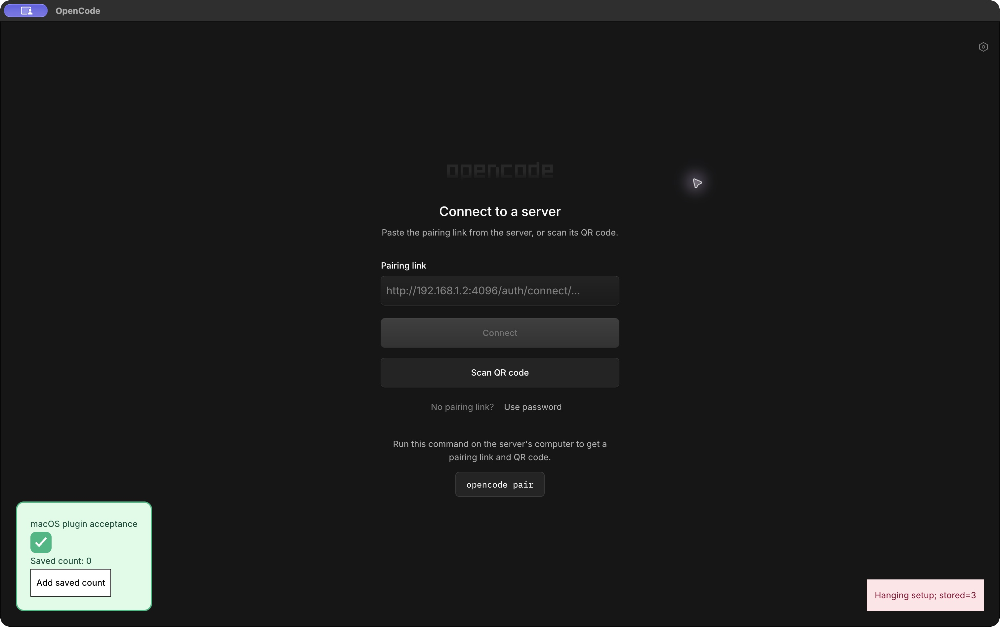
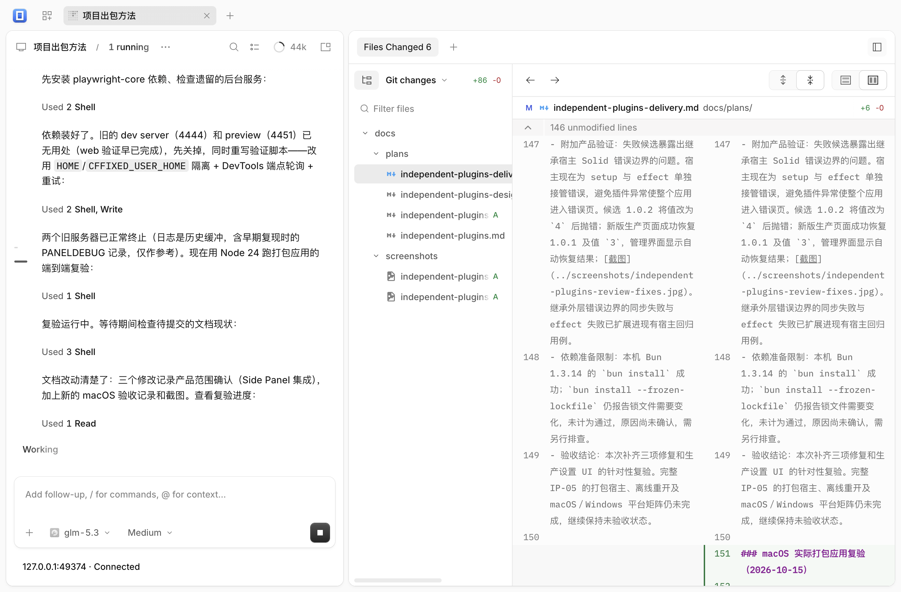
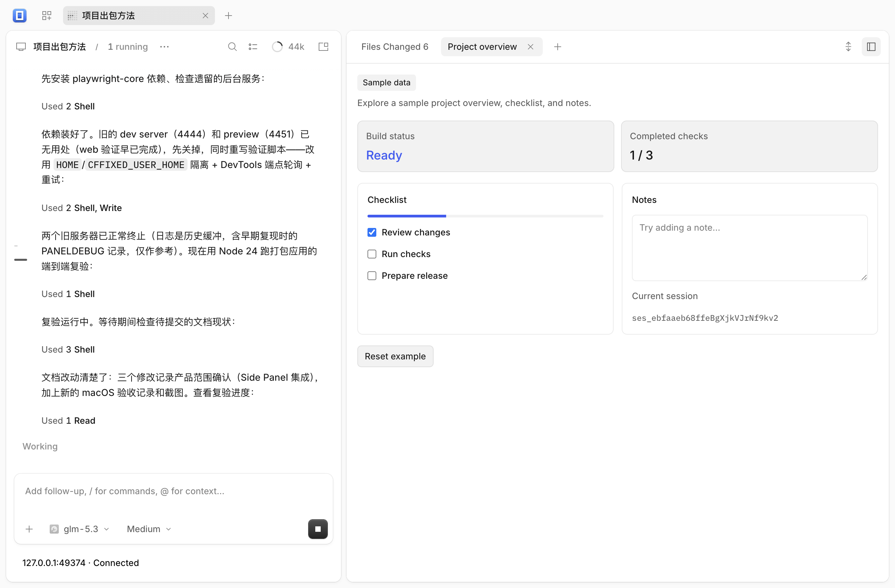

# 独立插件 macOS 实机验证（2026-10-15）

返回[实施与验收](independent-plugins-delivery.md)。本次验证实际打包应用的插件安装与生命周期；IP-05 的完整平台矩阵仍未完成。

## 环境与产物

- 源码：`work 9f732a5796d43acfd1b71e615f99cc9875f13ab1`。
- 系统：macOS 27.0.1（26A434），Apple Silicon arm64。
- 宿主：Electron 44.4.5，前端 2.0.29，客户端 2.0.29+0。
- 生产构建：`bun run build` 成功；保留已有的 CSS `::highlight` 优化警告。
- 打包：执行仓库的 `desktop-stage.cjs` 和 `desktop-package.mjs darwin arm64 2.0.29`。本机 Node 26.11.1 首次打包以未完成的顶层 await 退出；使用本机提供的 Node 24.19.0 后完成。此结果不代表已验证 Node 26 打包兼容性；CI 使用的 Node 22 本次未另行测试。
- 分发形态：按发布流程生成 tar.gz，再解出其中的 `.app` 并启动，没有使用运行时夹具替代产品界面。
- `codesign --verify --deep --strict` 通过；逐个 Mach-O 验证 ad hoc 签名，未启用会阻止此类签名加载框架的 hardened runtime/library validation 标志。归档解出后再次通过签名校验。

## 隔离与边界

测试进程启动时设置 `HOME` 和 `CFFIXED_USER_HOME`，指向忽略目录 `dist/macos-acceptance/isolated-home`。先通过 Foundation 验证 Application Support 路径，再通过运行中进程的打开文件确认 Electron 的 IndexedDB、Local Storage 和窗口状态都写入该测试目录。

原有 `~/Library/Application Support/opencode-front` 的文件内容摘要在前后保持一致。原有 OpenCode 服务与 CodeArts Proxy 的进程 ID 保持不变；没有输入凭据、连接后端或改动服务。测试应用主进程 PID 26765 始终保持，未执行应用进程重启；窗口重开时渲染器 PID 从 26770 变为 26847，最后一次重开后为 26915。

## 实际界面验证

所有操作均通过 macOS 原生窗口、文件选择器和产品插件管理界面完成。

范围更正（2026-10-16）：下述绿色卡片和探针用于动态加载、资源、数据与取消清理验证，使用的是 `app` 插槽。它们没有验证用户要求的现有 Side Panel 自定义面板。正式面板验收需安装 ZIP 后进入实际会话，从「+ Add tab」打开面板，并检查原生标签、布局、会话隔离与禁用／卸载清理；该流程已于 10-16 修复复验中在重新打包的应用上补验通过（见下节），禁用／卸载后的标签清理仍待专项验证。

| 场景 | 观察结果 | 结果 |
| --- | --- | --- |
| 干净测试资料目录启动打包应用 | 渲染器正常启动，入口为 `oc://renderer/`，连接界面和插件管理可进入 | 通过 |
| 固定宿主后生成独立 ZIP | 两个验收 ZIP 均在宿主打包后创建；宿主和应用内容摘要不变 | 通过 |
| 安装预览 | 展示包 ID、版本、能力和尺寸；确认前未出现插件卡片 | 通过 |
| 安装并启用 | 确认后立即出现插件卡片，无需重新构建宿主 | 通过 |
| 动态模块、共享 Solid、样式和图片 | Blob 模块执行；计数响应式更新；独立 CSS 的绿色卡片和本地 SVG 勾号正常呈现 | 通过 |
| 本地数据保存 | 点击三次后显示 `Saved count: 3` | 通过 |
| 窗口关闭与重开 | 新渲染器从本地恢复插件及值 `3`；主进程未退出 | 通过 |
| 最大化与窗口状态恢复 | 原生 zoom 操作后保存最大化标记；重开后仍为最大化，正常边界保持 1320×900 | 通过 |
| 重复启停 30 次 | 原生开关完成 30 个禁用／启用循环，最终插件可用，卡片未重复，保存值仍为 `3` | 通过 |
| setup 永不返回 | `acceptance.macos.hanging` 安装后保持挂起，管理界面仍可操作，其他插件可卸载和重装 | 通过 |
| 加载期间禁用与 owner cleanup | 关闭挂起插件的开关后，探针立即显示 `Hanging owner cleaned`，不再显示活动 setup | 通过 |
| 卸载保留数据 | 主插件卸载时不勾选删除数据，重装后仍显示 `Saved count: 3` | 通过 |
| 卸载删除数据与父子 ID 隔离 | 删除 `acceptance.macos` 的数据，重装后主插件归零；重新启用 `acceptance.macos.hanging` 仍读取原值 `3` | 通过 |
| 加载期间卸载 | 挂起子插件可卸载并删除数据，未被挂起 setup 阻塞 | 通过 |
| 卸载后窗口重开 | 清理两个插件后创建新渲染器，插件卡片与探针均未恢复 | 通过 |

## 摘要与复核

文件树摘要算法：按相对路径排序，逐个纳入常规文件的相对路径、NUL 字节和文件内容 SHA-256，再计算整体 SHA-256；符号链接不作为常规文件重复计入。签名校验另行覆盖应用结构。

| 对象 | SHA-256 |
| --- | --- |
| 生产前端文件树，插件生成及验收前后一致 | `7f836840c9448f86c7c476880c5e202bf8b0c79165a2c3d7f77edf6f8615e03d` |
| 打包 `.app` 文件树，归档解出后及验收前后一致 | `dad11458da28cebf0818896df729e0c161a137a1d549fd372eafb81818e0ec9a` |
| `opencode-front-macos-arm64-9f732a5.tar.gz` | `3778b707f0c8440a084b2c178ee88af8e13d33d395500b6a1edd1556846a2e8f` |
| `acceptance.macos-1.0.0.zip` | `34bbb722773bf1a59328c6f3e18dbb5717b171896abbaf03938aa0d4923c046e` |
| `acceptance.macos.hanging-1.0.0.zip` | `edb805826b474fda9c33c6f8f0ee3eebf3af3612f37e2d993d2f8d8fc3bf93a4` |

本机复核日志、测试 ZIP、隔离资料和结果 JSON 位于忽略目录 `dist/macos-acceptance/`。本次归档已被 10-16 重新出包取代，见下节；含缺陷的 `opencode-front-macos-arm64-9f732a5.tar.gz` 已从 `dist/` 移除。

## 会话 Side Panel 修复复验与重新出包（2026-10-16）

用户在 10-15 归档的打包应用中安装 `example.panel-demo` 后反馈：「+ Add tab」菜单出现「Project overview」，点击无反应，侧栏不打开。

### 根因与修复

- 根因：桥接层 `packages/app/src/extensions/plugin-panels.ts` 的注册 effect 依赖宿主 panels 状态；`open()` 写入该状态触发 effect 重跑，Solid 清理上一轮 owner，宿主撤销未受 `createRoot` 保护的 `Panel` 贡献，side region 的 transient 清理随即丢弃刚写入的存储 key。此前只有 `MenuItem` 受保护。
- 修复（提交 `ad5f23d`）：`Panel` 与 `MenuItem` 一并放入同一个 `createRoot`，返回合并的 remove 函数。回归测试 fixture 升级为用注册时的 owner 撤销贡献，与真实宿主一致；修复前 2 个测试失败，修复后 7/7 通过（`bun test --conditions=browser packages/app/test/plugin-panel-tabs.test.ts`），`bun run check` 全绿。
- 复现：生产构建与开发服务器在真实浏览器中复现同症状（插桩探针捕获贡献被撤销与 region 丢 key 的完整证据链），确认与用户症状一致；验证后全部插桩已移除。

### 打包应用复验

以 `work ad5f23d` 重新执行 `bun run build` → `desktop-stage.cjs` → `desktop-package.mjs darwin arm64 2.0.29`（Electron 44.4.5，Node 24.19.0）。`codesign --verify --deep --strict` 与仓库 `desktop-verify-macos.py` 启动冒烟通过。

随后以隔离 `HOME`/`CFFIXED_USER_HOME` 启动打包应用（`desktop-main.cjs` 从 `appData` 派生 userData，故以环境变量为隔离边界），通过 `--remote-debugging-port` 接入产品原生窗口完成：

1. 从产品插件管理界面安装 `example.panel-demo-1.0.0.zip`。
2. 以只读方式使用本机运行中的 `opencode serve --service`（`~/.local/state/opencode/service.json` 发现机制）连接真实后端；未启动、停止或重启后端，凭据不落盘不打印。
3. 打开实际会话，点击「Toggle review」展开侧栏。
4. 点击「+ Add tab」→「Project overview」。

| 检查项 | 结果 |
| --- | --- |
| 侧栏标签 | `["Files Changed 6", "Project overview"]`，插件面板与原生 Review 标签共存 |
| 插件面板内容 | `data-component="plugin-panel-content"` 渲染插件实际内容（Build status、Checklist、Notes、当前会话） |
| 隔离 | 测试数据全部写入测试专用 `HOME`；用户真实 `~/Library/Application Support/opencode-front` 未受影响（其 IndexedDB 修改时间仍为 2026-09-30，早于本次测试） |
| 后端 | 进程未被触碰，认证只读使用 |

新归档 `dist/opencode-front-macos-arm64-ad5f23d.tar.gz`，SHA-256 `8fdaf30491834a26b640b68ad1c872eda17fce5a2f2fc977109be6a2fbf8ecbb`。插件 ZIP（`example.panel-demo-1.0.0.zip` 等）为纯宿主侧修复，无需重建。

严格断网、Windows 实机、长期资源测量与完整冷启动恢复仍未覆盖；上述「尚未覆盖」清单中除会话内插件面板外其余继续有效。IP-05 维持未验收状态。

## 尚未覆盖

- 未退出整个应用进程后验证已安装插件的冷启动恢复；本次仅创建了新的窗口和渲染器，遵守不重启运行中应用的仓库边界。
- 10-15 当次没有连接后端，未通过实际会话触发命令面板和会话内插件面板（验收卡片使用产品的 `app` 插槽）；会话内插件面板已于 10-16 修复复验中补验，命令面板仍未覆盖。
- 未切断系统网络；验证了无服务连接下从包内资源及本地存储恢复，严格断网场景未计为通过。
- 未测量 DOM、监听器和内存的长期资源增长；30 次启停不等价于无泄漏证明。
- 未验证下载后带 quarantine 的 Gatekeeper／公证流程；本地 ad hoc 签名验证和实际启动已通过，没有绕过系统安全提示。
- Windows 实际打包应用尚未验证。
