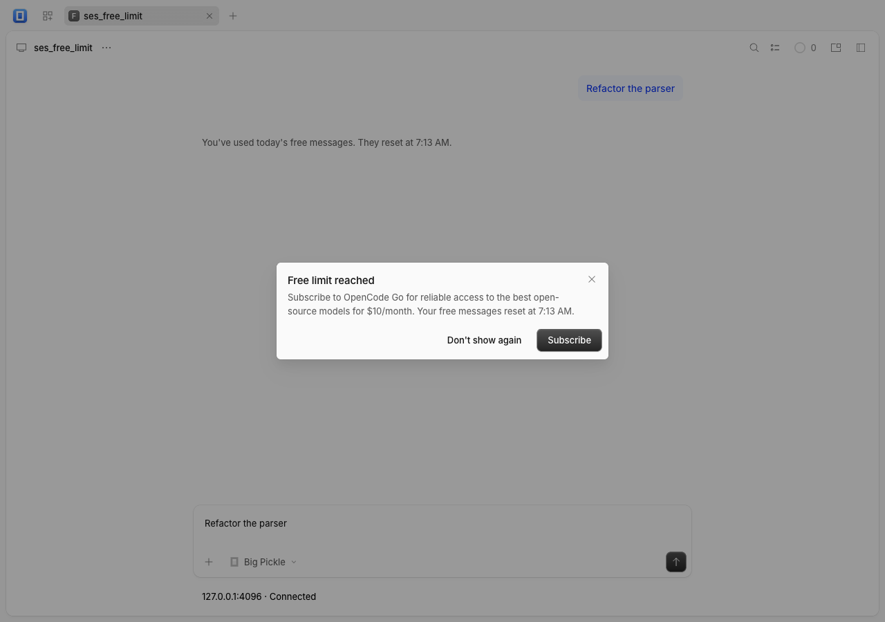

# OpenCode v2.1.2 sync

The frontend follows upstream **v2.1.2**, commit `a517687fde98a7329ada3ae644a01a9fc6c4e99e`, verified against origin's advertised tag on 2026-10-21 (Asia/Shanghai). The authoritative baseline was v2.1.1 at `ba546ec1598a70db2570e9c6258028d955ba8f58`. Root/Electron SemVer is `2.1.2+0`, corresponding to a future `2.1.2.0` tag. This port does not create a release.

## Import review and preservation

The plan selected 3,272 files: **22 changed**, no additions or removals, no collisions and no missing roots. Exact-commit inventory recording passed with **3,224 pristine files and 48 declared overlays**. Import rules, exclusions and dependency patches remain unchanged.

- Import typed `retryAfterMs` error metadata, current client/protocol generation and the optional `location_idle_timeout` configuration contract. No backend implementation is included or managed.
- Import the free-tier usage-limit dialog, localized timeline notice and reset time. Restore a rejected prompt only when the composer is empty, and retain existing drafts and attachments. Subscription completion selects the model in the current session and restores focus.
- Merge the `session-panels` overlay's `screen.tsx` hook arguments while retaining every plugin panel mount. Merge three `frontend-tooling` manifest version overlays; all other imported changes remain pristine.
- Preserve compact project groups, project-specific new-session actions, fixed avatar/chevron geometry, instance/worktree isolation, grouping/order preferences, floating history/search, browser plugins, native CodeArts panels and existing-service attachment. All port-owned adapter implementations and other overlay mounts are unchanged.
- Align the port's Electron dependency to upstream's **44.9.1**, matching the retained GUI package. The root catalog and patch set otherwise have no changes. Bun stays at exactly 1.3.14.
- Update README, root/public NOTICE, provenance and inventory. Upstream MIT attribution and license files remain unchanged.

## Validation

Every shell invocation prepended `$HOME/.local/share/opencode-bun-1.3.14/bin` to PATH. `bun --version` reported **1.3.14**. Work ran on branch `codex/upstream-v2.1.2` in the reused clean automation worktree `/Users/augustine/Dev/opencode-sync/opencode-front-v2.1.1`, created from fetched `origin/main`. The main checkout's unrelated `bun.lock` modification was preserved.

| Command | Result |
| --- | --- |
| `bash scripts/check-upstream.sh` from the automation folder | `UPDATE_AVAILABLE`; remote tag and commit verified |
| `bun run upstream:plan --source ../opencode --ref a517687fde98a7329ada3ae644a01a9fc6c4e99e` | Passed; counts above |
| `bun install --linker=hoisted` | Passed; lockfile changes limited to workspace versions and Electron; repeat install leaves lockfile byte-identical |
| `bun run upstream:record --source ../opencode --ref a517687fde98a7329ada3ae644a01a9fc6c4e99e` | Passed exact-source identity verification |
| `bun run check` | Passed import audit, all typechecks and **92 tests / 521 assertions** |
| `bun run build` | Passed production/PWA build |
| `bun test work/v2.1.2/upstream-tests/packages/schema work/v2.1.2/upstream-tests/packages/protocol work/v2.1.2/upstream-tests/packages/client work/v2.1.2/upstream-tests/packages/session-ui` | **113 tests / 432 assertions passed** |
| `PLAYWRIGHT_SERVER_PORT=4096 bun x playwright test --config work/v2.1.2/playwright.config.ts -g 'the free usage limit'` | Passed against production build in Chrome; zero page errors |
| `node scripts/desktop-stage.cjs 2.1.2.0` | Passed; staged metadata `2.1.2+0` / `2.1.2.0` verified; no desktop launch |
| `git diff --check` | Passed |

Additional tests were extracted from Git objects at the selected commit into ignored `work/v2.1.2/upstream-tests/`. Relative production imports point at this port; excluded story fixtures were extracted as test-only dependencies. They cover structured-error round trips including reset delays, current timeline rows/free-limit error placement, legacy credential/transcript migration, event manifests, terminal diagnostics, cursor round trips and client compaction/usage. Bun tests use upstream's default conditions. The main suite also retains its Node HTTP fetch/cancellation fixture.

The upstream composer E2E keeper and shared mock-server/workspace helpers were extracted into the same ignored folder. The workspace helper explicitly seeds the mock service in the port's server picker; the production port requires an existing-service connection rather than a managed default service. The test uses synthetic credentials and intercepted provider responses. It proves prompt recall, reset-time notice, subscription/model selection without creating another tab, persistent "Don't show again", and attachment-only draft preservation. A screenshot and page-error assertion were added only to the disposable test. No real provider sign-in or billing request occurred.



Initial browser invocations used an incorrect static-preview working directory or omitted `UX_FIXTURE_URL`; they failed navigation before application checks. Correcting those test invocation settings resolved the failures without source changes. Existing CSS optimization, Sentry dynamic-import, chunk-size and Vite config-loader warnings remain non-fatal.

## Production browser checks and benchmarks

Before importing session/timeline changes, built the production adapter fixture and measured it; rebuilt and repeated afterward. All five existing keepers passed with zero page errors: connection validation/recovery, plugin preview/import/cancel/mobile flows, project groups and scoped creation, history pagination/cancellation/retry and version information.

```sh
bun x vite build --config packages/app/performance/ux/vite.config.ts
bun x vite preview --config packages/app/performance/ux/vite.config.ts
# In a separate terminal, from packages/app:
bun x vite preview --host 127.0.0.1 --port 4444 --strictPort
# From the repository root:
export CHROMIUM_PATH="/Applications/Google Chrome.app/Contents/MacOS/Google Chrome"
export UX_FIXTURE_URL=http://127.0.0.1:4445
node packages/app/performance/ux/history-benchmark.mjs work/v2.1.2/history-after.json
node packages/app/performance/ux/benchmark.mjs work/v2.1.2/groups-after.json
node packages/app/performance/ux/connection.mjs
UX_SCREENSHOT=work/v2.1.2/plugins.png node packages/app/performance/ux/plugins.mjs
UX_SCREENSHOT=work/v2.1.2/groups.png node packages/app/performance/ux/groups.mjs
UX_SCREENSHOT=work/v2.1.2/history.png node packages/app/performance/ux/history.mjs
UX_SCREENSHOT=work/v2.1.2/version.png node packages/app/performance/ux/version.mjs
```

Chrome 155.0.8059.85, 1280×900; one warm-up and ten samples per workload, including two animation frames. Raw samples and environment fields are in [benchmark evidence](upstream-v2.1.2-benchmarks.json).

| Median duration | Before | After |
| --- | ---: | ---: |
| History first-match selection | 26.05 ms | 26.25 ms |
| Group popup, 20 sessions | 31.60 ms | 32.10 ms |
| Group popup, 100 sessions | 32.00 ms | 31.80 ms |
| Group popup, 500 sessions | 32.00 ms | 32.50 ms |

History slowest sample was 28.80 → 27.60 ms. These small differences do not establish a meaningful performance change. Fixtures exercise production adapters with simulated data; they do not measure full virtualized transcripts or native desktop performance.

## Unverified interactions

No desktop application was launched. Native macOS/Windows packaging and interaction, Electron 44.9.1 runtime behavior, live-service v2.1.2 event interoperability, older-service compatibility, real provider sessions and full transcript performance remain unverified. No backend or existing application was started, stopped, upgraded or restarted. Only this run's disposable static-preview processes were used.
