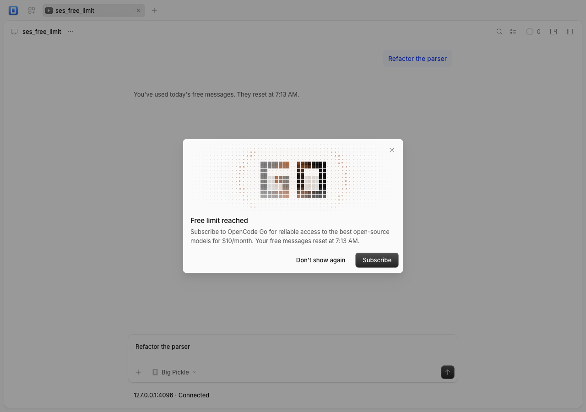
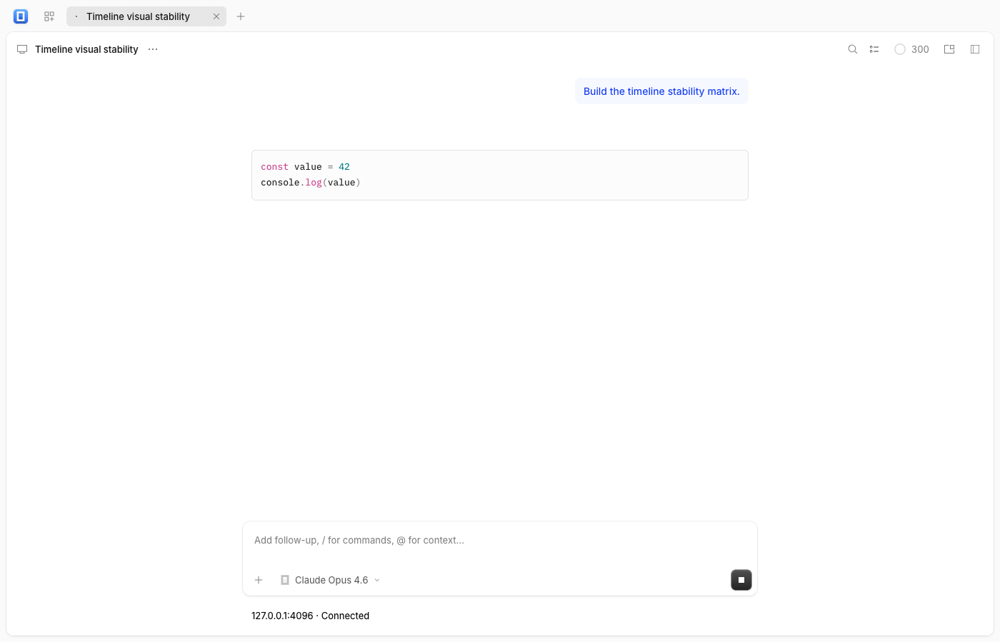

# OpenCode v2.1.3 sync

The frontend is pinned to OpenCode **v2.1.3**, commit **bb25a2f4a3f3f04d7c344bec0c0574ea3510b3b1**, from the verified origin tag. The previous baseline was v2.1.2 / a517687fde98a7329ada3ae644a01a9fc6c4e99e.

## Changes and preservation

- Replace Markdown streaming/completed-code highlighting and diff-view highlighting with upstream Pierre Highlights. Import its theme, worker disposal/reset behavior and language display names; remove obsolete Shiki theme/context modules.
- Import the ScrollView capture-phase pointer listener so scrollbar-thumb drags count as user scrolling. Preserve floating search/history mounts.
- Merge plaintext-only title editing and its drag-activation exclusion into the two project-tab overlays. Preserve compact grouping, project-specific creation, server/worktree isolation, fixed avatar/chevron geometry and persisted ordering.
- Import the free-limit dialog's Go illustration, reduced-motion behavior and lifecycle cleanup.
- Import voice-model discovery and hosted-session instruction contracts, generated clients/OpenAPI, tolerant legacy agent-color decoding and the durable-event schema annotation fix. These are client contracts only; no backend or provider connection was changed.
- Merge versions in three frontend-tooling manifests. Align the root catalog to upstream's @pierre/diffs 1.6.1, @pierre/highlights 0.2.0 and @types/bun 1.4.3, removing the direct stream tokenizer entry. Runtime remains Bun exactly 1.3.14; Electron stays 44.9.1.
- Preserve browser plugins, native CodeArts panels, existing-service attachment and all port-owned adapters. Update provenance, README, notices and inventory; upstream MIT attribution remains intact.

The original plan selected 31 changed, 5 added and 3 removed files, with no collisions or missing roots. The UI/session-ui Bun configurations newly reference the excluded Solid JSX compiler helper. Import policy now keeps exactly packages/ui/test/solid-jsx.ts as an explicit exception, adding one further pristine file. Other test exclusions and the frontend dependency patch list are unchanged. Exact-source recording verifies **3,227 pristine files and 48 declared overlays**.

## Validation

Every shell invocation used the required Bun 1.3.14 PATH prefix. Work ran from fetched origin/main on codex/upstream-v2.1.3, reusing the clean automation worktree. PR #10 was already merged and there were no open sync PRs. The primary checkout's existing bun.lock change was preserved.

| Command/check | Result |
| --- | --- |
| bash scripts/check-upstream.sh in the automation folder | UPDATE_AVAILABLE; v2.1.3 remote tag/commit verified |
| bun run upstream:plan --source ../opencode --ref bb25a2f4a3f3f04d7c344bec0c0574ea3510b3b1 | Original plan passed; counts above |
| bun install --linker=hoisted | Passed; repeat install leaves lockfile byte-identical |
| bun run upstream:record --source ../opencode --ref bb25a2f4a3f3f04d7c344bec0c0574ea3510b3b1 | Exact-commit verification passed |
| bun run check | Import audit, all typechecks and **92 tests / 521 assertions** passed |
| bun run build | Production/PWA build passed |
| Extracted upstream contract/Markdown tests | **284 tests / 671 assertions** passed |
| Extracted illustration tests with --preload ./packages/app/happydom.ts | **3 tests / 18 assertions** passed |
| bun test work/v2.1.3/contracts.test.ts | **2 tests / 7 assertions** passed; legacy color fallback and voice discovery/session/instructions using an in-memory fetch |
| Production Playwright checks | **7 distinct checks passed**, detailed below |
| Five existing production browser keepers | Passed; zero page errors |
| node scripts/desktop-stage.cjs 2.1.3.0 | Metadata verified as 2.1.3+0 / 2.1.3.0; no desktop launch |
| git diff --check | Passed |

Upstream tests/support fixtures were extracted from the exact selected Git commit into ignored work/v2.1.3/upstream-tests/; relative production imports were redirected to this port. The default-conditions suite covers schema/error/cursor/event contracts, client usage/compaction, timeline rows, Markdown streaming/worker protocol/queue/transport, file language names, parser theme variables and unknown fence languages. The hero suite verifies reduced motion, pixel-ratio redraw and unmount cleanup. Its first invocation omitted the DOM preload and failed before executing tests; the corrected invocation passed.

Production Chrome checks used intercepted mock services, synthetic credentials and provider responses. The shared helpers explicitly seed the mock server because this port requires existing-service attachment. The first unadapted upstream browser invocation failed at connection/navigation; seeding the mock server resolved it without production changes.

    bun test work/v2.1.3/upstream-tests/packages/schema work/v2.1.3/upstream-tests/packages/protocol work/v2.1.3/upstream-tests/packages/client work/v2.1.3/upstream-tests/packages/session-ui work/v2.1.3/upstream-tests/packages/ui
    bun test --preload ./packages/app/happydom.ts work/v2.1.3/upstream-tests/packages/app/src
    PLAYWRIGHT_SERVER_PORT=4096 bun x playwright test --config work/v2.1.3/playwright.config.ts -g 'the free usage limit|a tab does not reopen|keeps moving upward while drag-selecting|does not pull a keyboard-scrolled'
    PLAYWRIGHT_SERVER_PORT=4096 bun x playwright test --config work/v2.1.3/playwright.config.ts port-v2.1.3.spec.ts
    PLAYWRIGHT_SERVER_PORT=4096 bun x playwright test --config work/v2.1.3/playwright.config.ts -g 'follows an expanded patch that arrives'

These prove free-limit prompt recall/dialog/subscription model selection and suppression preferences, rename-in-flight behavior, drag selection, keyboard scrolling during remeasurement, completed/streaming code tokens in the production Markdown worker, direct scrollbar-thumb dragging, and expanded patch bottom following. The port-specific Markdown/thumb checks assert no page errors. The free-limit keeper also passed with reduced motion and a visible illustration.

Existing non-fatal CSS optimization, Sentry dynamic-import, chunk-size and Vite native-config warnings remain.

## Production benchmarks and keepers

Built the production adapter fixture before the session/timeline import and rebuilt it afterward. Chrome 155.0.8059.85, viewport 1280×900; one warm-up and ten samples per workload, including two animation frames. Raw environment/samples are in [benchmark evidence](upstream-v2.1.3-benchmarks.json).

| Median duration | Before | After |
| --- | ---: | ---: |
| History first-match selection | 26.10 ms | 26.10 ms |
| Group popup, 20 sessions | 31.50 ms | 32.30 ms |
| Group popup, 100 sessions | 32.00 ms | 31.40 ms |
| Group popup, 500 sessions | 32.00 ms | 33.60 ms |

History slowest sample was 28.60 → 27.50 ms. Popup results vary by -0.60 to +1.60 ms; these short synthetic samples do not establish a meaningful regression. They measure adapter interactions, not full virtualized transcripts or native desktop performance.

    bun x vite build --config packages/app/performance/ux/vite.config.ts
    bun x vite preview --config packages/app/performance/ux/vite.config.ts
    # A separate disposable production preview from the repository root:
    bun x vite preview --host 127.0.0.1 --port 4444 --strictPort --outDir packages/app/dist
    export CHROMIUM_PATH="/Applications/Google Chrome.app/Contents/MacOS/Google Chrome"
    export UX_FIXTURE_URL=http://127.0.0.1:4445
    node packages/app/performance/ux/history-benchmark.mjs work/v2.1.3/history-after.json
    node packages/app/performance/ux/benchmark.mjs work/v2.1.3/groups-after.json
    node packages/app/performance/ux/connection.mjs
    UX_SCREENSHOT=work/v2.1.3/plugins.png node packages/app/performance/ux/plugins.mjs
    UX_SCREENSHOT=work/v2.1.3/groups.png node packages/app/performance/ux/groups.mjs
    UX_SCREENSHOT=work/v2.1.3/history.png node packages/app/performance/ux/history.mjs
    UX_SCREENSHOT=work/v2.1.3/version.png node packages/app/performance/ux/version.mjs

All five keepers passed: connection validation/recovery, plugin preview/import/cancel/mobile, project groups/scoped creation/fixed avatar-chevron geometry, history pagination/cancellation/retry and version information.

## Unverified interactions

Native macOS/Windows packaging and interaction, live/older-service interoperability (including the new voice endpoints), real provider sessions, full transcript performance and the upstream Storybook Markdown component matrix remain unverified. Production Markdown rendering and changed timeline behaviors were exercised directly as described above. No real voice session or billing request occurred.

No backend or existing application was started, stopped, upgraded or restarted. No desktop app was launched; only disposable static previews were used. No merge, tag, release or desktop artifact upload is authorized by this automation.
