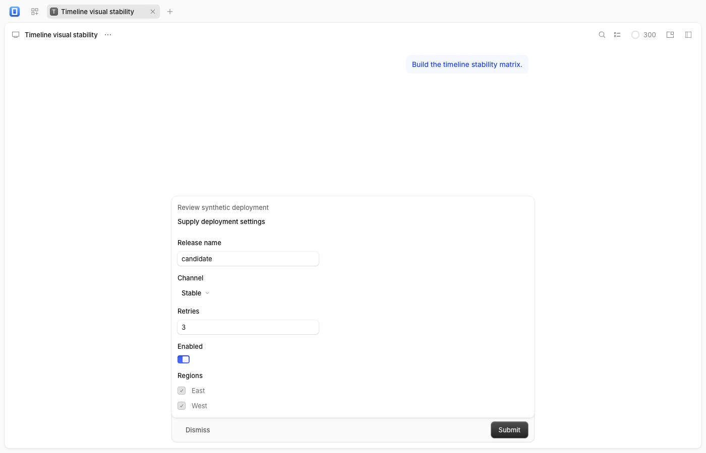

# OpenCode v2.1.4 sync

The frontend is pinned to OpenCode **v2.1.4**, commit **68bc26b7da1990ce10ffecfbc1e09eb13aa5d824**, verified against origin's stable tag. The previous main baseline was v2.1.3 / bb25a2f4a3f3f04d7c344bec0c0574ea3510b3b1.

## Changes and preservation

- Import MCP elicitation docks for typed fields and external authorization URLs. Session-owned and location-owned requests block the composer while they await a response; location-owned replies retain their directory header.
- Import the client MCP WebSocket helper, ticket endpoint contracts, generated clients/OpenAPI and experimental background-compaction configuration. Background compaction remains opt-in; this port does not implement or manage that backend feature.
- Import event-to-message ID normalization, location-switch project clearing, compaction failure contract cleanup, schema/utility simplifications, documentation links and worker subpath resolution.
- Import debug heap capture contracts and renderer availability gating. The upstream main entries remain dormant in this frontend-only port; no heap dump was requested from a real service or desktop process.
- Merge four declared overlays: app/client/plugin-browser manifest versions and the app English dictionary. Add the client MCP export and its upstream test-only SDK dependency; retain the browser plugin's RPC-only export and frontend-only dependencies. All plugin, native CodeArts, project-group, floating-search/history, existing-service and version-information adapters remain unchanged.
- The root catalog follows upstream's OpenTUI 0.6.8 entries. Keep Bun exactly 1.3.14, Electron 44.9.1 and the existing TypeScript 7.0.2 toolchain. The new upstream 7.1.0-beta compiler reports TS5115 for existing PostCSS selector types in the plugin resource adapter. The stable compiler passes. The app/client tooling overlays retain their compatible tsc commands rather than the newer Bun check builtin.
- Update provenance, README, NOTICE and inventory. Import rules, all test exceptions, dependency patches and MIT attribution remain unchanged. The MCP SDK is a development dependency for client transport tests; its upstream server OAuth patch remains outside the frontend patch scope.

The original plan contains **59 changed, 8 added and 3 removed files**, with no collisions or missing roots. Exact-source recording verifies **3,232 pristine files and 48 declared overlays**.

## Validation

All shell invocations used the required Bun 1.3.14 PATH prefix. Work started from freshly fetched origin/main on codex/upstream-v2.1.4 in the clean automation worktree. There were no open PRs; #11 was already merged. The primary checkout's existing bun.lock modification was preserved.

| Command/check | Result |
| --- | --- |
| bash scripts/check-upstream.sh in the automation folder | UPDATE_AVAILABLE; selected remote v2.1.4 and exact commit verified |
| bun run upstream:plan --source ../opencode --ref 68bc26b7da1990ce10ffecfbc1e09eb13aa5d824 | Passed; counts above |
| bun install --linker=hoisted | Passed; repeat install leaves lockfile byte-identical |
| bun run upstream:record --source ../opencode --ref 68bc26b7da1990ce10ffecfbc1e09eb13aa5d824 | Exact-source verification passed |
| bun run check | Boundary audit, all root typechecks and **92 tests / 521 assertions** passed |
| bun x tsc --noEmit -p packages/client/tsconfig.json | Passed, including the new MCP public leaf |
| bun run build | Production/PWA build passed |
| Extracted upstream contracts, Markdown, client and memory-summary tests | **353 tests / 977 assertions** passed |
| Extracted application tests with DOM preload | **17 tests / 34 assertions** passed |
| Extracted server heap adapter tests with DOM preload | **2 tests / 2 assertions** passed |
| bun test work/v2.1.4/contracts.test.ts | **2 tests / 10 assertions** passed; opt-in config and generated ticket/heap paths, headers and queries using in-memory fetch |
| Production browser checks | Typed MCP form, location-owned mobile request, Markdown worker and scrollbar dragging passed |
| Five existing production browser keepers | Passed; zero page errors |
| node scripts/desktop-stage.cjs 2.1.4.0 | Metadata 2.1.4+0 / 2.1.4.0 verified; no desktop launch |
| git diff --check | Passed |

Tests/support were extracted from the exact selected commit into ignored work/v2.1.4/upstream-tests, redirecting relative production imports to this port. Contracts cover configuration/schema hygiene, events/cursors, client usage/compaction/data/pending status, MCP initialization/tools/errors/reconnect/backoff/disposal, timeline rows and Markdown workers/parsers.

The upstream MCP tests use a Bun 1.4.4 WebSocket fixture. On Bun 1.3.14, retaining its Request after upgrade loses the URL and its cleanup can hang. The disposable fixture uses Node HTTP/ws with the same MCP SDK and assertions. Its successful four-test transport run is also recorded separately. The extracted schema source audit points at the real source directory; the request-tree alias points at this port; heap adapter tests use their required DOM registration lifecycle. Initial fixture failures were corrected without changing production code.

    bun test work/v2.1.4/upstream-tests/packages/schema work/v2.1.4/upstream-tests/packages/protocol work/v2.1.4/upstream-tests/packages/client work/v2.1.4/upstream-tests/packages/session-ui work/v2.1.4/upstream-tests/packages/ui work/v2.1.4/upstream-tests/packages/gui-extensions/src/debug/memory-infra.test.ts
    bun test --preload ./packages/app/happydom.ts work/v2.1.4/upstream-tests/packages/app/src
    bun test --preload ./packages/app/happydom.ts work/v2.1.4/upstream-tests/packages/gui-extensions/src/debug/server-heap.test.ts
    bun test work/v2.1.4/contracts.test.ts
    PLAYWRIGHT_SERVER_PORT=4096 bun x playwright test --config work/v2.1.4/playwright.config.ts elicitation.spec.ts markdown-scroll.spec.ts

Browser checks use an intercepted synthetic service, seeded registry and synthetic provider data. They verify string/integer/boolean/select/multiselect values, hidden-field exclusion and submitted answer; location-owned external links, mobile width, Escape cancellation and the directory header; completed/streaming code highlighting and scrollbar position retention. Initial form checks used the wrong select role, checkbox hit target, page-only popup interception and query-based location expectation; the corrected checks drive visible controls, intercept the browser context and assert the actual directory-header contract. No production fix was needed.

Existing CSS optimization, Sentry mixed-import, chunk-size, native-config and plugin-timing warnings are non-fatal.

## Production benchmarks and keepers

Built the production adapter fixture before session edits, recorded the baseline, rebuilt after import and measured again. Chrome 155.0.8059.86, 1280×900, one warm-up and ten measured samples including two animation frames. Raw samples and environment are in [benchmark evidence](upstream-v2.1.4-benchmarks.json).

| Median duration | Before | After |
| --- | ---: | ---: |
| History first-match selection | 26.35 ms | 25.80 ms |
| Group popup, 20 sessions | 33.40 ms | 32.40 ms |
| Group popup, 100 sessions | 32.30 ms | 33.60 ms |
| Group popup, 500 sessions | 33.50 ms | 33.20 ms |

History slowest sample was 27.20 → 27.00 ms. Short synthetic samples show no meaningful regression; these measurements do not establish transcript, native desktop or live-service performance.

    bun x vite build --config packages/app/performance/ux/vite.config.ts
    bun x vite preview --config packages/app/performance/ux/vite.config.ts
    bun x vite preview --host 127.0.0.1 --port 4444 --strictPort --outDir packages/app/dist
    export CHROMIUM_PATH="/Applications/Google Chrome.app/Contents/MacOS/Google Chrome"
    export UX_FIXTURE_URL=http://127.0.0.1:4445
    node packages/app/performance/ux/history-benchmark.mjs work/v2.1.4/history-after.json
    node packages/app/performance/ux/benchmark.mjs work/v2.1.4/groups-after.json
    node packages/app/performance/ux/connection.mjs
    UX_SCREENSHOT=work/v2.1.4/plugins.png node packages/app/performance/ux/plugins.mjs
    UX_SCREENSHOT=work/v2.1.4/groups.png node packages/app/performance/ux/groups.mjs
    UX_SCREENSHOT=work/v2.1.4/history.png node packages/app/performance/ux/history.mjs
    UX_SCREENSHOT=work/v2.1.4/version.png node packages/app/performance/ux/version.mjs

The existing keepers prove connection validation/recovery, plugin preview/import/cancel/mobile behavior, scoped project creation and group selection, history paging/cancellation/retry and version information.

## Unverified interactions

Native macOS/Windows packaging/runtime and heap capture IPC, real provider sessions, live/older-service MCP interoperability, and full transcript performance remain unverified. Tests exercise synthetic endpoints and a disposable local WebSocket peer; no real authorization, model execution, billing or heap capture occurred.

No backend or existing application was started, stopped, upgraded or restarted. No desktop app was launched. Only disposable static previews were used. No merge, tag, release or desktop artifact upload is authorized by this automation.
